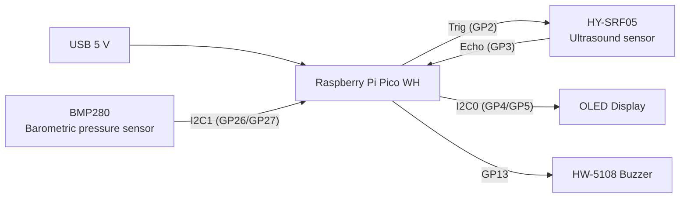
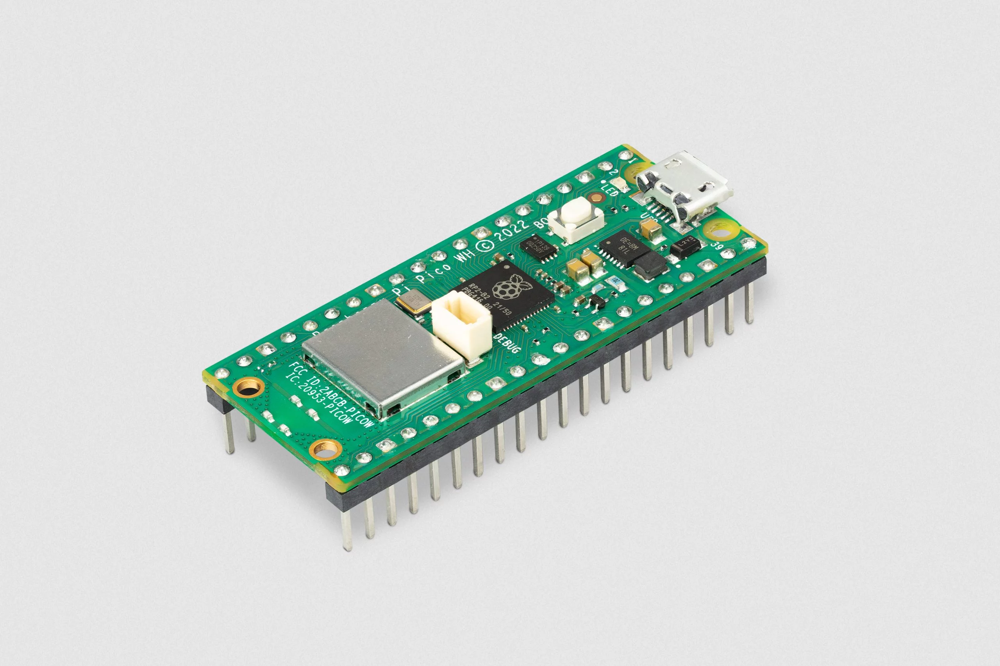
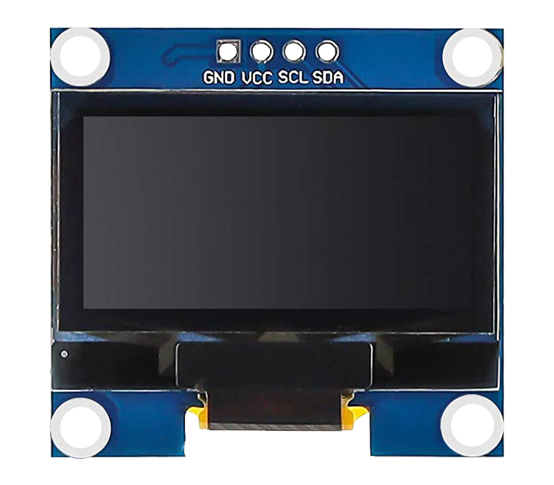
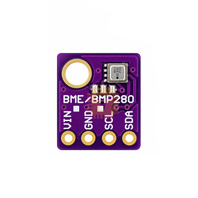

# BPC-DE2-project: Ultrasonic distance instrument
Project for the bachelor subject Digital Electronics 2, 2026  

Setup and operating instructions, including required MicroPython modules.
Hardware inventory and any assumptions or limitations.

## Team members and the work
| Name | Responsibility |
| :--- | :------------- |
| [Patrik Malý](https://github.com/Patik05) | Responsible for the documentation. |
| [David Kovář](https://github.com/Lidong9) | Responsible for the code. |
| [Samuel Adamec](https://github.com/afflorld) | Responsible for the code, circuit diagram. |

## The problem
Real-world appliances or vehicles (like cars) use sensors in order to detect a possible item in the nearby vicinity. The sensor gets used to help detect a possible collision with an object in time, so that said object can be avoided. But not all situations are ideal and ultrasound sensors can have problems with detection. So we use a barometer to simulate such cases.

##  Main objective/problem
Measure distance at a steady interval and show the result and a visual near/far indication via danger bar. When the distance gets too small, a buzzer makes a noise. Also, usage of the barometric pressure sensor that decreases the accuracy of the ultrasound sensor.

## Circuit diagram/schematics

| Pin | Device | Description  |
| :--: | :---- |  :----------- |
| GP2  | HY-SRF05 Ultrasound sensor | Trig pin. Starts the measurement. |
| GP3  | HY-SRF05 Ultrasound sensor | Echo pin. Returns the measured signal. |
| GP4  | OLED Display | SDA pin, I2C0. Address 0x3C. |
| GP5  | OLED Display | SCL pin, I2C0. Address 0x3C. |
| GP13 | HW-5108 Buzzer | Signal pin for the buzzer. |
| GP26 | BMP280 Barometric pressure sensor | SDA pin, I2C1. Address 0x76. |
| GP27 | BMP280 Barometric pressure sensor | SCL pin, I2C1. Address 0x76. |
| 3V3  | All devices | 3.3 V power supply. |
| GND  | All devices | Common ground. |

### Block diagram

 

### Wiring diagram

## How to run
- First, it is required to have the latest Micropython extension be donwloaded. Either the use of code editors like VSCode or Thonny will do.
- Connect the board to the computer via USB and then use the donwloaded Micropython extension to connect the board the code editor.
- Import the libraries on the board
- Run the [main.py]() with the Micropython extension (not F5, but instead the "Run" command on the bottom of the editor)
Not sure which libraries? All of the libraries included in this repository is enough.

## Used hardware
The code runs on the <b>Raspberry Pi Pico WH © 2022</b>.

<i>The board in question.</i>
It is the main brain that holds the project together. The board itself can supply all the components with the required voltage and pins. 
 

<i>HY-SRF05 Ultrasound sensor</i>
A cheap ultrasound sensor that comes with most microcontroller/microprocessor kits. Its selling point is it ease of use and the cheap price. However, the sensor itself has limted range that in theory works from 2 cm to 400 cm. The longer the range, the less accurate it may be, but for our application it does the job fine.
 

<i>SSD1306 OLED Display</i>
Small OLED display with 4 pins. Again, easy to use. Its easybility of use is also well documented in [doc. Tomas's repository](https://gitlab.fekt.vut.cz/fryza/micropython-course-labs/-/tree/main/lab6-serial?ref_type=heads). The main disadvantage of this module is its small screen. Therefore it does not give us too much room to put information on it.
 

<i>HW-5108 Buzzer</i>
Classical buzzer. Our version has three pins and only two were used. It has supply from 3.3V power source and buzzes noise within our hearing range. For our purposes, it work just well.
 

<i>BMP280 Baromteric pressure sensor</i>
Small module with four pins. In our project, when temperature increases on it, the ultrasound inaccuracy increases.
 

## Poster
[Project poster]() 
<i>Pre-prepared part, thus not yet implemented</i>

## Showcase video
[Showcase video]() 
<i>Pre-prepared part, thus not yet implemented</i>

## Used tools
- Github: Documentation, repository home.
- VSCode: Home edits for the repository.
- Wokwi: Circuit diagram

## References
1. Micropython. [Micropython official site](https://micropython.org/)
