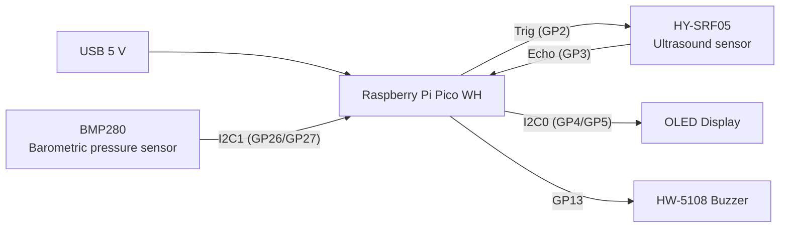
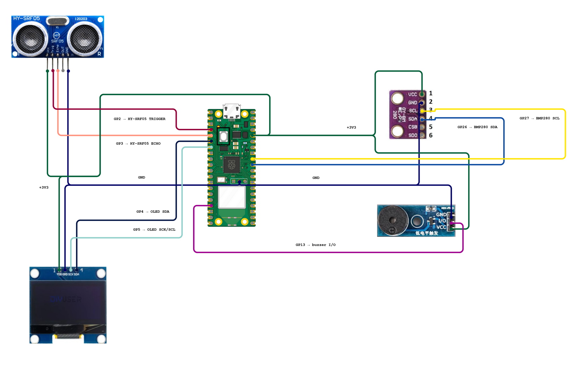
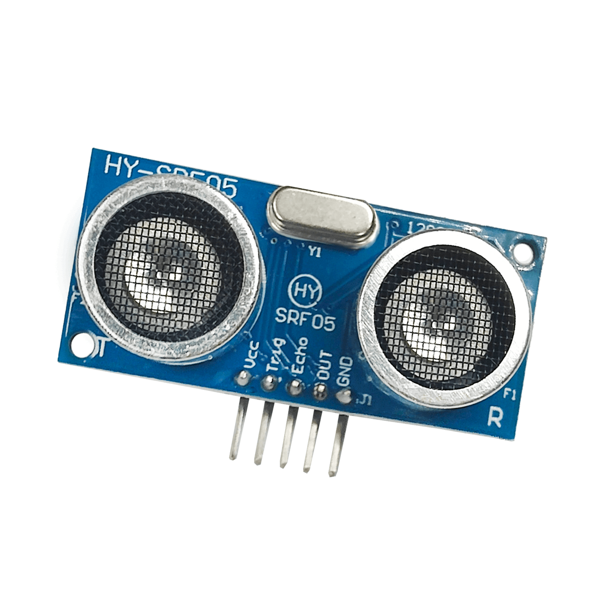
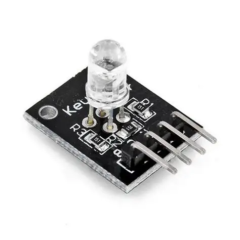

# BPC-DE2-project: Ultrasonic distance instrument
Project for the bachelor subject Digital Electronics 2, 2026  

## Team members and the work
| Name | Responsibility |
| :--- | :------------- |
| [Patrik Malý](https://github.com/Patik05) | Responsible for the documentation. |
| [David Kovář](https://github.com/Lidong9) | Responsible for the code. |
| [Samuel Adamec](https://github.com/afflorld) | Responsible for the code, circuit diagram. |

## The problem
Modern real-world vehicles (like cars) use sensors in order to detect a possible obstacle in the cars way and warn the driver of a possible colision. But not all situations are ideal and ultrasound sensors can have problems with detection.

##  Main objective/problem
This project measures distance at a steady interval and shows the result via visual near/far indication danger bar on the OLED display. When the distance gets too small then a buzzer makes a noise. Also, the project implements a barometer that decreases the ultrasound sensor accuracy when temperature increases.

## Circuit diagram/schematics

| Pin | Device | Description  |
| :--: | :---- |  :----------- |
| GP2  | HY-SRF05 Ultrasound sensor | Trig pin. Starts the measurement. |
| GP3  | HY-SRF05 Ultrasound sensor | Echo pin. Returns the measured signal. |
| GP4  | OLED Display | SDA pin, I2C0. Address 0x3C. |
| GP5  | OLED Display | SCL pin, I2C0. Address 0x3C. |
| GP13 | HW-5108 Buzzer | Signal pin for the buzzer. |
| GP26 | BMP280 Barometric pressure sensor | SDA pin, I2C1. Address 0x76. |
| GP27 | BMP280 Barometric pressure sensor | SCL pin, I2C1. Address 0x76. |
| 3V3  | All devices | 3.3 V power supply. |
| GND  | All devices | Common ground. |

### Block diagram

 

### Wiring diagram

## How to run
- First, it is required to have the latest Micropython extension be donwloaded. Either the use of code editors like VSCode or Thonny will do.
- Connect the board to the computer via USB and then use the donwloaded Micropython extension to connect the board the code editor.
- Import the libraries on the board
- Run the [main.py](src/main.py) with the Micropython extension (not F5, but instead the "Run" command on the bottom of the editor)
Not sure which libraries? All of the libraries included in this repository is enough.

## Used software
Code runs on Micropython 1.29.0
Used python files:
#### main.py

The function serves to run the main part of the program, using all the project libraries. It defines the time periods used, pins used and how the program should behave.

#### bme280.py

[Imported library](https://randomnerdtutorials.com/micropython-bme280-esp32-esp8266/). It defines the readings on the BME/BMP280 module and helps us get the current temperature.

#### hcsr04.py

[Imported library](https://github.com/rsc1975/micropython-hcsr04). It utilizes the HCSR04 ultrasound sensor and allows to measure distance in either mm or cm, depending on the function used. 

#### sh1106.py

[Imported library](https://github.com/tomas-fryza/esp-micropython/blob/main/modules/sh1106.py) Simplifies the usage of the OLED SSD1306 display. 

#### Built-in MicroPython modules

No external packages need to be installed, only the modules built into MicroPython (v1.29.0) are used besides the files from the `src` folder:

| Module | Used in | Purpose |
| :----- | :------ | :------ |
| `machine` (`Pin`, `I2C`, `PWM`, `time_pulse_us`) | main.py, hcsr04.py, sh1106.py | GPIO, I2C buses, PWM for the RGB LED, echo pulse length measurement. |
| `time` / `utime` | main.py, bme280.py, hcsr04.py, sh1106.py | Timing (`ticks_ms`, `ticks_diff`, `ticks_add`, `sleep_ms`, `sleep_us`). |
| `framebuf` | sh1106.py | Frame buffer for drawing text and shapes on the OLED. |

Version of the bundled library: `hcsr04.py` 0.2.1.

### Timing

All time constants are defined at the top of [main.py](src/main.py). The main loop runs every `LOOP_MS` and each task is executed using non-blocking `time.ticks_ms()` comparison.

| Constant | Value | Description |
| :------- | :---: | :---------- |
| `LOOP_MS` | 10 ms | Main loop step, which is also the buzzer timing resolution. |
| `MEAS_PERIOD_MS` | 100 ms | Distance measurement interval (10 Hz), also refreshes the OLED display and RGB LED. |
| `TEMP_PERIOD_MS` | 2000 ms | Temperature read interval of the BMP/BME280 sensor (used to correct the speed of sound). |
| `HOLD_MS` | 500 ms | The last valid distance is kept during short echo dropouts. |
| `BEEP_FAST_MS` | 50 ms | Buzzer on/off time at `NEAR_CM` (10 cm) or closer. |
| `BEEP_SLOW_MS` | 500 ms | Buzzer on/off time at `FAR_CM` (100 cm). In between the time changes linearly; farther than `FAR_CM` the buzzer is silent. |
| `echo_timeout_us` | 30000 us | Echo timeout of the HC-SR04 sensor (30 ms, approx. 5 m); no echo means out of range. |
| I2C0 (OLED) | 400 kHz | Bus frequency of the display. |
| I2C1 (BMP280) | 100 kHz | Bus frequency of the temperature sensor. |
| RGB LED PWM | 1 kHz | PWM frequency of the LED channels. |

## Used hardware
The code runs on the <b>Raspberry Pi Pico WH © 2022</b>.

<i>The board in question.</i>

It is the main brain that holds the project together. The board itself can supply all the components with the required voltage and pins. 
 

<i>HY-SRF05 Ultrasound sensor</i>

A cheap ultrasound sensor that comes with most microcontroller/microprocessor kits. Its selling point is it ease of use and the cheap price. However, the sensor itself has limted range that in theory works from 2 cm to 400 cm. The longer the range, the less accurate it may be, but for our application it does the job fine.
 

<i>SSD1306 OLED Display</i>

Small OLED display with 4 pins. Again, easy to use. Its easybility of use is also well documented in [doc. Tomas's repository](https://gitlab.fekt.vut.cz/fryza/micropython-course-labs/-/tree/main/lab6-serial?ref_type=heads). The main disadvantage of this module is its small screen. Therefore it does not give us too much room to put information on it.
 

<i>HW-5108 Buzzer</i>

Classical buzzer. Our version has three pins and only two were used. It has supply from 3.3V power source and buzzes noise within our hearing range. For our purposes, it work just well.
 

<i>BMP280 Baromteric pressure sensor</i>

Small module with four pins. In our project, when temperature increases on it, the ultrasound sensor inaccuracy increases.
 

<i>RGB LED</i>
Extra visual danger indicator, that turns red when the distance of the sensor and the measured object gets to low.
 

## Poster
[Project poster]() 
<i>Pre-prepared part, thus not yet implemented</i>

## Showcase video
[Showcase video]() 
<i>Pre-prepared part, thus not yet implemented</i>

## Used tools
- Github: Documentation, repository home.
- VSCode: Home edits for the repository.
- [cirkitdesigner](app.cirkitdesigner.com): Circuit diagram

## References
1. Micropython. [Micropython official site](https://micropython.org/)
